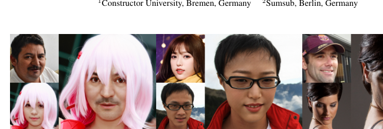
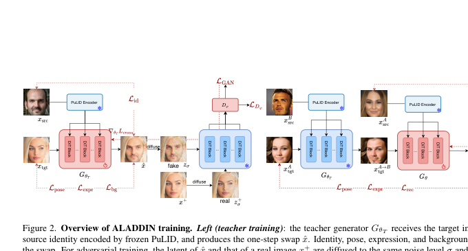
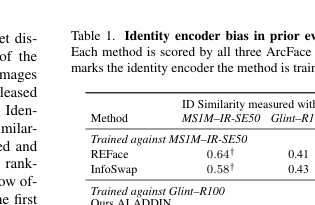
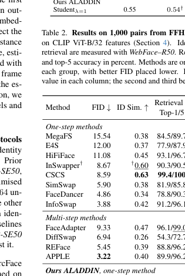
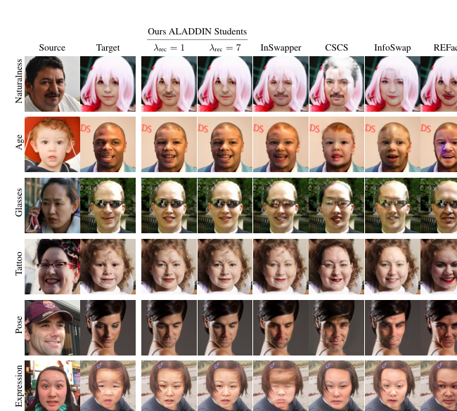
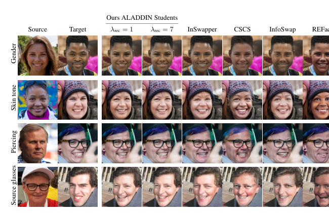
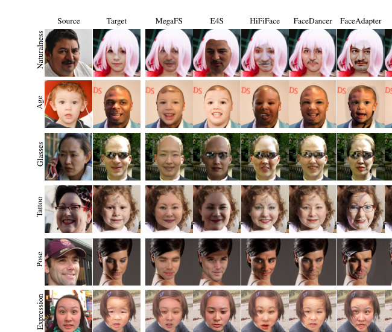
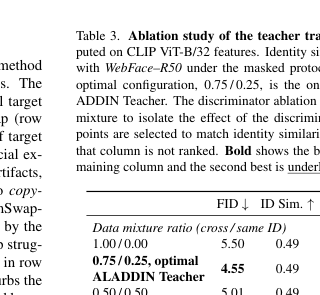
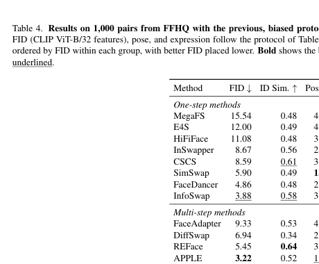

# ALADDIN：用于单步身份交换的对抗式潜空间扩散蒸馏

> 英文题目：**Adversarial Latent Diffusion Distillation for One-Step Identity Swapping**  
> 作者：Ivan Shchekotov、Timofei Gritsaev、Viacheslav Pirogov、Dmitry Vetrov  
> 机构：Constructor University、Sumsub  
> 原文：arXiv:2610.37503v1，2026-10-27  
> 说明：本文档按原论文结构进行详细中文翻译与技术解读，保留全部公式、5 幅图片、4 张表及补充材料。参考文献编号沿用原文。

---

## 一、论文核心内容概览

ALADDIN 是一种**只需一次神经网络前向计算（1 NFE）的人脸身份交换模型**。输入包括：

- **源图像** \(x_{\mathrm{src}}\)：提供需要迁移的人物身份；
- **目标图像** \(x_{\mathrm{tgt}}\)：提供姿态、表情、发型、眼镜、光照、服饰和背景；
- **输出图像** \(\hat{x}\)：身份应与源图像一致，其余属性尽可能与目标图像一致。

现有 GAN 换脸模型推理很快，但通常真实感较弱；扩散模型真实感强，却需要几十次网络计算。ALADDIN 的做法是：

1. 从预训练的多步 FLUX 流匹配模型初始化生成器；
2. 使用冻结扩散模型的中间特征构造判别器；
3. 使用身份、姿态、表情、背景及重建损失进行约束；
4. 先训练教师模型，再利用三元组伪标签训练学生模型；
5. 通过学生阶段的重建权重 \(\lambda_{\mathrm{rec}}\)，显式控制“身份迁移强度”和“目标属性保持程度”的取舍。

主要结论：

- 在单步模型中，ALADDIN 的真实感和目标属性保持能力达到最优水平；
- 与 28 步 APPLE 相比，ALADDIN 只需 1 次网络计算，推理计算量减少约 \(28\times\)；
- 训练图像对数量减少一个数量级；
- 作者发现既有评测常用与训练相同的身份编码器，导致身份相似度存在正向偏差，并提出独立编码器评测协议。

---

## 二、图 1：总体换脸效果

**图 1 中文说明：** 每组示例左上角为源身份，左下角为目标图像，右侧为模型输出。模型把源人物身份迁移到目标上，同时保留目标的姿态、表情、发型、眼镜、光照和背景。

---

## 三、摘要翻译

人脸交换的目标，是把源图像中的人物身份迁移到目标图像，同时保留目标图像的姿态、表情、头发和光照。当前最逼真的方法通常基于扩散模型，但每生成一张图像都需要多次网络计算。GAN 方法速度快，但从零开始训练时，只能依赖对抗信号学习真实感，因此生成质量明显较弱。

本文提出 **ALADDIN**（Adversarial LAtent Diffusion Distillation for One-Step Identity SwappiNg）：一种单步人脸交换模型。其生成器由预训练的多步流匹配模型初始化，并在身份保持和目标属性保持约束下进行对抗训练。作者进一步使用三元组伪标签监督训练学生模型，使身份迁移与目标属性保持之间的取舍可以调节。

论文还指出，标准评测协议存在偏差：如果某种方法在训练时使用了与评测相同的身份编码器，那么该方法的身份分数会被高估。作者因此使用独立身份编码器重新评测所有基线。

在身份迁移能力相近时，ALADDIN 在单步方法中取得最先进的真实感和目标属性保持效果；它还可匹配最佳多步方法 APPLE，但网络计算次数减少 28 倍，训练图像对数量减少一个数量级。

---

## 四、引言

人脸交换需要把源人物身份迁移到目标人脸，同时保持目标图像中的背景、头发、姿态、表情、光照和配饰。其应用包括影视制作和隐私保护。

早期系统只能从固定人脸库中替换，或需要大量人工操作；现代方法则主要依赖神经网络。

### 4.1 GAN 路线

GAN 换脸方法大致分为两类：

1. **直接生成方法**：如 SimSwap、HiFiFace、FaceDancer、InfoSwap。它们端到端训练生成器，同时优化身份、属性保持和对抗损失。
2. **GAN 反演方法**：如 MegaFS、E4S。它们先把真实人脸映射到预训练 StyleGAN 的潜空间，再对潜变量进行身份替换。

直接生成方法必须仅依赖对抗训练从头学习图像真实感，同时还要平衡身份和属性目标，因此在大姿态、脸型变化或遮挡场景下容易出现局部伪影。反演方法继承了 StyleGAN 的图像先验，但真实图像反演可能丢失身份细节，或把潜变量推到生成器训练分布之外。

### 4.2 扩散路线

扩散模型具有更强的图像先验和更稳定的训练过程，通常比 GAN 更逼真，但推理需要数十次网络计算。已有换脸模型包括 DiffFace、DiffSwap、REFace、FaceAdapter、DreamID 和 APPLE。

- DiffFace：身份条件 DDPM，采样时使用身份、语义和视线梯度引导，计算开销大；
- DiffSwap：采用三维感知掩码扩散，并使用关键点和人脸掩码保持姿态与表情；
- REFace：把潜扩散建模为条件修复任务，在训练中展开多个 DDIM 步；
- FaceAdapter：把身份、空间结构和属性条件显式分离；
- DreamID：利用三元组身份组构造换脸真值，并基于 SD-Turbo 实现一步生成；
- APPLE：改进伪三元组构造，目标属性保持更强，但仍为多步模型，训练成本较高。

### 4.3 本文贡献

1. 提出 ALADDIN：一种简单、单步、在单步方法中达到最先进质量的人脸交换方法；
2. 超过几乎所有多步基线，并达到 APPLE 的质量，但训练图像对少一个数量级，推理网络计算次数少 28 倍；
3. 揭示既有身份相似度评测中的编码器偏差，并使用独立模型重新评测所有基线。

---

## 五、方法

### 5.1 单步条件生成

给定源图像 \(x_{\mathrm{src}}\) 和目标图像 \(x_{\mathrm{tgt}}\)，生成器 \(G_\theta\) 一步产生换脸结果：

$$
\hat{x}
=G_\theta(x_{\mathrm{src}},x_{\mathrm{tgt}})
=x_{\mathrm{tgt}}
-\sigma_{\mathrm{gen}}
v_\theta(x_{\mathrm{tgt}},\sigma_{\mathrm{gen}},x_{\mathrm{src}}).
\tag{1}
$$

其中：

- \(\hat{x}\)：生成图像；
- \(v_\theta\)：带源身份条件的流匹配模型所预测的速度；
- \(\sigma_{\mathrm{gen}}\)：固定生成噪声级别，设为 \(0.2\)；
- \(x_{\mathrm{tgt}}\) 被视为位于噪声级别 \(\sigma_{\mathrm{gen}}\) 的样本；
- 公式实际在冻结的 FLUX VAE 潜空间中执行，之后再解码到图像空间。

\(\sigma_{\mathrm{gen}}=0.2\) 使模型训练初期不会离预训练初始化过远，因而提供较温和、稳定的初始状态。

### 5.2 图 2：完整训练框架

**左侧——教师训练：**

- 教师生成器 \(G_{\theta_T}\) 接收目标图像和经冻结 PuLID 编码的源身份；
- 单步生成 \(\hat{x}\)；
- 使用身份、姿态、表情和背景损失约束结果；
- 将生成图像和真实图像的潜变量扩散到相同噪声级别；
- 通过冻结扩散模型提取中间特征；
- 判别器 \(D_\phi\) 判断特征来自真实图像还是生成图像。

**右侧——学生训练：**

- 冻结教师先根据身份 \(B\) 和身份 \(A\) 的目标图生成伪目标 \(x_{\mathrm{tgt}}^{A\to B}\)；
- 学生再把身份 \(A\) 换回该伪目标；
- 因为真实图像 \(x_{\mathrm{tgt}}^A\) 已知，所以可以使用重建损失直接监督。

---

## 六、训练目标与全部公式

### 6.1 身份损失

通过最小化生成图像和源图像身份嵌入之间的余弦距离，促进身份迁移：

$$
\mathcal{L}_{\mathrm{id}}(\hat{x},x_{\mathrm{src}})
=1-\cos\left(
f_{\mathrm{id}}(\hat{x}),
f_{\mathrm{id}}(x_{\mathrm{src}})
\right).
\tag{2}
$$

\(f_{\mathrm{id}}\) 是冻结的人脸识别网络。当两个身份嵌入的余弦相似度达到 1 时，损失为 0，表示身份迁移充分。

### 6.2 对抗真实感损失

仅使用身份损失时，模型很容易让输出在身份特征空间接近源图像，却可能产生严重伪影。因此作者同时使用对抗训练；在存在真值的训练组中还使用重建损失。

令冻结 VAE 编码器为 \(E\)，则：

$$
z=E(\hat{x}),\qquad z^+=E(x^+).
$$

其中 \(z\) 为生成换脸图的潜变量，\(z^+\) 为真实图像 \(x^+\) 的潜变量；实现中同一批次的目标图像作为真实样本。两者使用同一个噪声级别 \(\sigma\) 和噪声 \(\epsilon\) 做线性扰动：

$$
z_\sigma=(1-\sigma)z+\sigma\epsilon,
\qquad
\epsilon\sim\mathcal{N}(0,I).
$$

真实分支同理得到 \(z_\sigma^+\)。之后将二者输入冻结扩散模型，截取 \(K\) 个模块的中间激活：

$$
h^{(1)},h^{(2)},\ldots,h^{(K)}.
$$

每一层激活由独立判别头读取，最终真实感得分为：

$$
D_\phi(z_\sigma)
=
\sum_{k=1}^{K}
w_kD_{\phi_k}\!\left(h^{(k)},\sigma\right),
\qquad
\mathbf{w}=\operatorname{softmax}(\boldsymbol{\alpha}).
\tag{3}
$$

只有判别头 \(\{D_{\phi_k}\}\) 和聚合权重的 logits \(\boldsymbol{\alpha}\) 可训练，扩散模型本身保持冻结。可学习权重让训练过程自行决定哪些层的特征最有判别价值。

判别器采用非饱和 GAN 目标。\(D_\phi\) 输出样本为真实图像的概率：

$$
\mathcal{L}_{D_\phi}(z_\sigma^+,z_\sigma)
=-\log D_\phi(z_\sigma^+)
-\log\left(1-D_\phi(z_\sigma)\right).
\tag{4}
$$

生成器的对抗损失为：

$$
\mathcal{L}_{\mathrm{GAN}}(z_\sigma)
=-\log D_\phi(z_\sigma).
\tag{5}
$$

关键思想是：判别器不直接读取像素或原始潜变量，而读取预训练扩散模型的中间特征。不同深度的特征已经编码了从全局脸部几何结构到皮肤微观纹理的多尺度先验，因此判别器不必仅从对抗信号中重新学习“真实人脸应是什么样子”。

### 6.3 重建损失

当训练对中的源图像和目标图像属于同一身份时，目标图像本身就是正确输出，因此可定义：

$$
\mathcal{L}_{\mathrm{rec}}(\hat{x},x_{\mathrm{tgt}})
=d(\hat{x},x_{\mathrm{tgt}}).
\tag{6}
$$

\(d\) 可以是 \(\ell_1\)、\(\ell_2\) 或感知距离。实验发现 LPIPS 比 \(\ell_1\) 有更好的定量结果，因此最终采用 LPIPS。

### 6.4 姿态损失

作者使用冻结的 6DRepNet 估计头部方向：

$$
\psi_{\mathrm{pose}}(x)=R_x\in SO(3).
$$

旋转矩阵的三列分别表示头部局部坐标系中的右、上、前三个方向。生成图与目标图姿态的测地距离为：

$$
\mathcal{L}_{\mathrm{pose}}(\hat{x},x_{\mathrm{tgt}})
=
\arccos\!\left[
\operatorname{clip}\!\left(
\frac{
\operatorname{tr}\!\left(
R_{\hat{x}}R_{x_{\mathrm{tgt}}}^{\top}
\right)-1
}{2},
-1+\varepsilon,
1-\varepsilon
\right)
\right].
\tag{7}
$$

其中：

$$
R_{\hat{x}}=\psi_{\mathrm{pose}}(\hat{x}),
\qquad
R_{x_{\mathrm{tgt}}}=\psi_{\mathrm{pose}}(x_{\mathrm{tgt}}).
$$

估计器参数不更新，但梯度会通过 \(\psi_{\mathrm{pose}}(\hat{x})\) 回传至生成器。

### 6.5 表情损失

冻结的 DECA 为每张图像预测一个 50 维 FLAME 表情向量 \(\psi_{\mathrm{expr}}(x)\)。其维度对应学习到的表情 blendshape 权重，描述微笑、皱眉、张嘴等非身份几何形变，并与身份脸型、全局姿态、外观和光照分离。

$$
\mathcal{L}_{\mathrm{expr}}(\hat{x},x_{\mathrm{tgt}})
=
\frac{1}{2d_{\mathrm{expr}}}
\left\|
\psi_{\mathrm{expr}}(\hat{x})
-\psi_{\mathrm{expr}}(x_{\mathrm{tgt}})
\right\|_2^2.
\tag{8}
$$

其中 \(d_{\mathrm{expr}}=50\)。该损失相当于系数维度上的一半均方误差，并在批次上取平均。

### 6.6 背景损失

作者用冻结的 SegFormer 人脸解析模型生成目标人脸掩码 \(m_{\mathrm{tgt}}\)，对边界进行膨胀和平滑，再二值化。掩码包含皮肤、鼻子、眉毛、眼睛、嘴、嘴唇和耳朵；补集 \(1-m_{\mathrm{tgt}}\) 则包含目标图像的头发、眼镜、耳环、帽子、脖子、服装和普通背景。

在掩码外区域计算归一化像素差：

$$
\mathcal{L}_{\mathrm{bg}}(\hat{x},x_{\mathrm{tgt}})
=
\frac{
\displaystyle
\sum_{c,h,w}
\left(1-m_{\mathrm{tgt}}^{h,w}\right)
\left|
\hat{x}^{c,h,w}-x_{\mathrm{tgt}}^{c,h,w}
\right|
}{
\displaystyle
\max\!\left(
1,
\sum_{h,w}
\left(1-m_{\mathrm{tgt}}^{h,w}\right)
\right)
}.
\tag{9}
$$

---

## 七、三类训练数据组

### 7.1 跨身份组（Cross Identity Group）

当：

$$
\operatorname{ID}(x_{\mathrm{src}})
\ne
\operatorname{ID}(x_{\mathrm{tgt}}),
$$

使用完整跨身份目标：

$$
\begin{aligned}
\mathcal{L}_{\mathrm{cross}}
(\hat{x},x_{\mathrm{src}},x_{\mathrm{tgt}})
=\;&
\lambda_{\mathrm{id}}
\mathcal{L}_{\mathrm{id}}(\hat{x},x_{\mathrm{src}})
+
\lambda_{\mathrm{GAN}}
\mathcal{L}_{\mathrm{GAN}}(\hat{x})\\
&+
\lambda_{\mathrm{pose}}
\mathcal{L}_{\mathrm{pose}}(\hat{x},x_{\mathrm{tgt}})
+
\lambda_{\mathrm{expr}}
\mathcal{L}_{\mathrm{expr}}(\hat{x},x_{\mathrm{tgt}})\\
&+
\lambda_{\mathrm{bg}}
\mathcal{L}_{\mathrm{bg}}(\hat{x},x_{\mathrm{tgt}}).
\end{aligned}
$$

身份损失负责身份迁移；GAN 损失负责真实感；后三项分别保持目标姿态、表情和背景。

### 7.2 同身份组（Same Identity Group）

当源图和目标图属于同一身份时：

$$
\begin{aligned}
\mathcal{L}_{\mathrm{same}}
(\hat{x},x_{\mathrm{src}},x_{\mathrm{tgt}})
=\;&
\lambda_{\mathrm{id}}
\mathcal{L}_{\mathrm{id}}(\hat{x},x_{\mathrm{src}})
+
\lambda_{\mathrm{GAN}}
\mathcal{L}_{\mathrm{GAN}}(\hat{x})\\
&+
\lambda_{\mathrm{rec}}
\mathcal{L}_{\mathrm{rec}}(\hat{x},x_{\mathrm{tgt}}).
\end{aligned}
$$

重建损失提供直接像素/感知监督，可提升图像质量。不能只用同身份组训练，因为模型简单复制目标图即可获得极低损失，却学不会真正的跨身份替换。姿态和表情损失无需单独加入，因为重建目标已经约束了这些属性。

### 7.3 三元组组（Triplet Group）

为了在源、目标身份不同时也使用重建损失，作者采用三元组伪标签。先取身份 \(A\) 的两张不同真实图像：

$$
(x_{\mathrm{src}}^A,x_{\mathrm{tgt}}^A).
$$

再取身份 \(B\) 的源图 \(x_{\mathrm{src}}^B\)，用冻结教师 \(G_{\theta_T}\) 生成伪目标：

$$
x_{\mathrm{tgt}}^{A\to B}
=
G_{\theta_T}
\left(
x_{\mathrm{src}}^B,
x_{\mathrm{tgt}}^A
\right).
$$

该伪目标具有身份 \(B\)，但保留 \(x_{\mathrm{tgt}}^A\) 的目标属性。之后让学生把身份 \(A\) 换回去：

$$
\hat{x}
=
G_\theta
\left(
x_{\mathrm{src}}^A,
x_{\mathrm{tgt}}^{A\to B}
\right).
$$

理论上，\(\hat{x}\) 应恢复身份 \(A\)，且继承伪目标中的属性；这些属性原本来自真实图 \(x_{\mathrm{tgt}}^A\)，所以 \(x_{\mathrm{tgt}}^A\) 可作为重建真值。

三元组目标为：

$$
\begin{aligned}
\mathcal{L}_{\mathrm{triplet}}
(\hat{x},x_{\mathrm{src}}^A,x_{\mathrm{tgt}}^A)
=\;&
\lambda_{\mathrm{id}}
\mathcal{L}_{\mathrm{id}}(\hat{x},x_{\mathrm{src}}^A)
+
\lambda_{\mathrm{GAN}}
\mathcal{L}_{\mathrm{GAN}}(\hat{x})\\
&+
\lambda_{\mathrm{rec}}
\Big[
\mathcal{L}_{\mathrm{rec}}(\hat{x},x_{\mathrm{tgt}}^A)
+
\lambda_{\mathrm{pose}}
\mathcal{L}_{\mathrm{pose}}(\hat{x},x_{\mathrm{tgt}}^A)\\
&\hspace{42mm}
+
\lambda_{\mathrm{expr}}
\mathcal{L}_{\mathrm{expr}}(\hat{x},x_{\mathrm{tgt}}^A)
\Big].
\end{aligned}
$$

### 7.4 两阶段训练

1. 教师在跨身份组和同身份组的混合数据上训练；
2. 学生由教师参数初始化，但判别器重新随机初始化；
3. 学生只在三元组数据上训练；
4. 冻结教师在线生成伪目标，不需要离线预计算；
5. 增大 \(\lambda_{\mathrm{rec}}\) 会提高真实感与目标属性保持，但削弱身份迁移。

论文把不同重建权重的学生记为 \(\mathrm{Student}_\lambda\)，实验报告 \(\lambda_{\mathrm{rec}}\in\{1,3,7\}\)。

---

## 八、实验设置

### 8.1 模型结构

- 生成器初始化：FLUX.1-Krea-dev；
- 身份编码器：PuLID；
- 属性条件分支：OminiControl；
- 判别器特征骨干：同一个冻结 FLUX.1-Krea-dev Transformer；
- 训练参数：所有 Transformer 块注意力投影上的 rank-64 LoRA，以及 PuLID 的交叉注意力层；
- 其余主干参数冻结；
- 分辨率：\(512\times512\)；
- 身份训练损失：在 Glint360K 上训练的 ArcFace；
- 源图进入身份编码器前先做人脸区域掩码，降低目标属性泄漏；
- 身份损失输入缩放为 \(112\times112\)，不做额外对齐。

### 8.2 训练数据

使用 VGGFace2-HQ 和 Arc2Face，二者都包含每个身份的多张图像，适合同身份组和三元组组。Arc2Face 与 VGGFace2-HQ 的批次采样比例为 \(4:1\)。

过滤后数据集包含：

- 约 410 万张图像；
- 约 54 万个身份。

过滤过程：

1. 使用 AES 美学质量预测器，丢弃分数低于 5.1 的图像；
2. 对每个身份，选择与其他图平均身份相似度最高的图作为锚点；
3. 只保留与锚点相似度位于 \([0.6,0.95]\) 的图像；
4. 新接纳图像必须与已接纳图像的相似度低于 0.95，以去除重复图片。

### 8.3 评测协议

在 REFace 使用的 1000 个固定 FFHQ 源—目标图像对上评测：

- **真实感**：生成的 1000 张图与全部 70000 张 FFHQ 图之间的 CLIP ViT-B/32 Fréchet 距离，文中简称 FID；越低越好；
- **身份相似度**：生成图与源图身份嵌入的余弦相似度；越高越好；
- **身份检索**：在全部源人脸中检索正确身份，报告 Top-1 和 Top-5；越高越好；
- **姿态保持**：Hopenet 估计的生成图与目标图姿态 \(\ell_2\) 距离；越低越好；
- **表情保持**：Deep3DFace 估计的表达差异；越低越好。

训练使用的姿态与表情估计器分别是 6DRepNet 和 DECA，评测使用 Hopenet 和 Deep3DFace，避免直接用训练监督网络给自己打分。

---

## 九、身份编码器偏差

既有论文常使用 MS1M–IR-SE50 同时进行训练、身份条件编码和评测。REFace 与 InfoSwap 都针对该编码器优化，因此用它评测会给予这些方法额外优势。

作者改用 **WebFace–R50** 作为独立评测器。它是 iResNet-50 ArcFace，在 WebFace600K 上训练；除 InSwapper 把它用作身份条件外，其他比较方法都未针对它训练。对 InSwapper，论文又额外用 MS1M–IR-SE50 比较，以降低单一编码器带来的偏差。

ALADDIN 的身份条件和身份损失使用 Glint–R100，而评测使用 WebFace–R50，因此模型未针对评测编码器优化。

### 表 1：既有协议中的身份编码器偏差

**表 1 中文数据：**

- REFace（针对 MS1M–IR-SE50 训练）：MS1M–IR-SE50 为 **0.64**，Glint–R100 为 0.41，WebFace–R50 为 0.39；
- InfoSwap（针对 MS1M–IR-SE50 训练）：MS1M–IR-SE50 为 **0.58**，Glint–R100 为 0.43，WebFace–R50 为 0.42；
- ALADDIN Student\(_{\lambda=1}\)（针对 Glint–R100 训练）：MS1M–IR-SE50 为 0.55，Glint–R100 为 **0.54**，WebFace–R50 为 0.50。

结论：模型在其训练所针对的编码器上明显得分更高。仅使用 MS1M–IR-SE50 会把 REFace 的身份相似度从独立编码器下的约 0.39–0.41 抬高到 0.64，从而改变方法排名。

---

## 十、主要定量结果

### 表 2：FFHQ 1000 对上的主结果

列顺序为：方法；FID（低优）；WebFace–R50 身份相似度（高优）；身份检索 Top-1/Top-5 百分比（高优）；姿态误差（低优）；表情误差（低优）。

**单步方法：**

- MegaFS：15.54；0.38；84.5/89.7；4.50；1.14。
- E4S：12.00；0.37；77.9/87.9；4.47；1.30。
- HiFiFace：11.08；0.45；93.1/96.7；3.20；1.34。
- InSwapper：8.67；0.60；90.3/90.5；2.80；1.52。其身份条件编码器与此处评测编码器相同。
- CSCS：8.59；**0.63**；**99.4/100**；3.70；1.45。
- SimSwap：5.90；0.38；81.9/85.8；1.83；0.96。
- FaceDancer：4.86；0.34；78.8/90.3；2.27；0.74。
- InfoSwap：3.88；0.42；91.2/96.1；3.18；0.99。

**多步方法：**

- FaceAdapter：9.33；0.47；96.1/99.0；4.01；1.20。
- DiffSwap：6.94；0.26；54.3/72.7；2.61；1.02。
- REFace：5.45；0.39；88.8/96.2；3.68；1.04。
- APPLE（28 步）：**3.22**；0.40；89.9/96.2；1.86；0.63。

**ALADDIN，全部为单步：**

- Teacher：4.55；0.49；96.4/98.2；1.90；0.77。
- Student\(_{\lambda=1}\)：4.49；**0.50**；**97.4/98.7**；1.93；0.76。
- Student\(_{\lambda=3}\)：3.66；0.44；94.0/97.6；1.68；0.65。
- Student\(_{\lambda=7}\)：3.34；0.40；88.9/95.3；**1.56**；**0.60**。

### 10.1 与单步方法比较

- ALADDIN 所有版本在全部四项指标上均超过 MegaFS 和 E4S；
- Teacher 和 Student\(_1\) 在所有指标上超过 HiFiFace；
- Student\(_3\) 在所有指标上超过 SimSwap、FaceDancer 和 InfoSwap；
- InSwapper 与 CSCS 的身份相似度更高，但真实感、姿态和表情明显更差；
- CSCS 的高身份分数部分来自直接粘贴源人脸，导致真实感和属性一致性降低；
- Student\(_1\) 和 Teacher 的 Top-1 检索率仅次于 CSCS。

### 10.2 与多步方法比较

- ALADDIN 所有版本在全部指标上超过 DiffSwap 和 REFace；
- Teacher 和 Student\(_1\) 在全部指标上超过 FaceAdapter；
- APPLE 是唯一仍具竞争力的多步基线；
- Student\(_7\) 与 APPLE 身份相似度相同（0.40），FID 接近（3.34 对 3.22），表情更优（0.60 对 0.63），姿态也更优（1.56 对 1.86）；
- APPLE 需要 28 步，而 ALADDIN 只需 1 步。

### 10.3 训练成本

- APPLE：教师使用 104 万图像对，学生另用 24 万图像对；4 张 A6000 共训练 12.78 天，其中 5.78 天用于以 28 步教师离线生成伪三元组；
- ALADDIN：教师只用 10 万图像对，4 张 H100 约 4.5 小时；学生只用 1.5 万图像对，约 50 分钟；
- ALADDIN 教师本身即为单步，因此伪目标可在线生成，不需要离线生成阶段。

---

## 十一、定性结果

### 图 3：主要方法对比

列从左到右为源图、目标图、ALADDIN Student\(_1\)、ALADDIN Student\(_7\)、InSwapper、CSCS、InfoSwap、REFace 和 APPLE。六行分别测试：

1. **自然度**：目标具有不常见发型；
2. **年龄**：源与目标年龄差很大；
3. **眼镜**：是否保持目标眼镜；
4. **纹身**：是否保持目标脸部纹身；
5. **姿态**：是否保持目标头部方向；
6. **表情**：是否保持目标表情。

观察：

- GAN 方法更容易产生严重伪影；
- CSCS 有明显复制粘贴倾向，对目标适配不足；
- InSwapper 身份迁移较强，但受原模型 \(128\times128\) 分辨率限制；
- InfoSwap 会改变目标头发、把眼镜镜片变透明，并扰动姿态和表情；
- REFace 常出现不真实纹理，且身份迁移不足；
- APPLE 是最强基线，但困难场景仍可能产生伪影；
- 三元组训练后，ALADDIN 以极低推理成本达到 APPLE 级真实感与属性保持；
- \(\lambda_{\mathrm{rec}}\) 越大，真实感和目标属性保持越强，但身份迁移越弱。

### 图 4：更多困难属性

四行分别测试：

- 跨感知性别身份迁移；
- 源与目标肤色差异显著；
- 是否保持目标的穿孔配饰；
- 是否避免把源图眼镜错误迁移到目标。

作者观察到：

- InfoSwap 未能正确迁移性别身份特征；
- REFace 会把肤色向源图方向偏移，而包括 ALADDIN 在内的其他方法保留目标肤色；
- ALADDIN 与 APPLE 能保持目标穿孔；
- CSCS 会错误地把源图眼镜带到结果中。

### 图 5：图 3 中未展示的其他方法

该图展示 MegaFS、E4S、HiFiFace、FaceDancer、FaceAdapter 和 DiffSwap 在与图 3 相同六类困难场景上的结果，用于补全全部基线的视觉比较。

---

## 十二、消融实验

消融只针对教师训练，不使用三元组组。为了公平比较，作者为每次训练选择身份相似度尽可能接近的收敛后检查点，使差异主要体现在 FID、姿态和表情。

### 表 3：教师训练消融

**数据混合比例（跨身份/同身份）：**

- \(1.00/0.00\)：FID 5.50；身份 0.49；姿态 2.20；表情 0.95；
- \(0.75/0.25\)，最终 Teacher：FID **4.55**；身份 0.49；姿态 1.90；表情 **0.77**；
- \(0.50/0.50\)：FID 5.01；身份 0.49；姿态 **1.87**；表情 0.79。

加入 25% 同身份数据，可通过真值重建明显改善 FID、姿态和表情；但把同身份比例提高到 50% 后，训练分布偏离实际跨身份部署场景，FID 从 4.55 恶化到 5.01。因此最佳比例为跨身份 75%、同身份 25%。

**判别器输入：**

- 用扩散中间特征、纯跨身份训练：FID 5.50；身份 0.49；姿态 2.20；表情 0.95；
- 改为原始潜变量：FID **20.46**；身份 0.53；姿态 2.82；表情 1.13。

原始潜变量判别器不包含“真实人脸应是什么样”的先验，很容易被生成器欺骗。它几乎无法提供有效真实感压力，使生成器主要迎合身份损失，产生严重伪影。该实验是论文最关键的消融证据。

---

## 十三、结论与局限

### 13.1 结论

ALADDIN 从预训练流匹配模型初始化生成器，并进行对抗训练。它不需要传统的显式蒸馏目标：预训练扩散模型以两种方式提供真实感先验：

1. 作为生成器的初始化；
2. 作为判别器的冻结特征提取器。

ALADDIN 在单步换脸模型中达到最先进水平，并在身份迁移、FID 和表情方面匹配最强多步基线 APPLE，在姿态上超过 APPLE，同时将网络计算次数从 28 次降到 1 次，训练数据减少一个数量级。

### 13.2 局限

- 对不常见的源身份，身份迁移能力下降；
- 源与目标年龄差很大时效果会下降；
- 目标保持最弱的 Student\(_1\) 可能丢失纹身；
- 这些仍是整个人脸交换领域尚未完全解决的问题。

### 13.3 伦理考虑

换脸可能被用于制作未经同意或具有欺骗性的内容，而单步模型会进一步降低大规模滥用成本。作者称其研究动机主要来自：

- 身份验证：生成真实换脸样本，用于训练和压力测试检测系统；
- 影视制作。

论文只使用既有换脸研究中常见的研究数据集，全部定性示例均来自 FFHQ。

---

## 十四、补充材料 A：完整实现细节

### 14.1 噪声与判别器特征

- 生成器固定噪声级别：\(\sigma_{\mathrm{gen}}=0.2\)；
- 判别器读取 \(K=4\) 个特征图；
- 特征来自冻结 Transformer 双流模块第 \(0,6,12,18\) 层；
- 判别噪声级别：

$$
\sigma\sim\mathcal{U}[0.01,0.4].
$$

- 生成器和判别器噪声均按调度器的分辨率相关 shift 重新缩放；
- 实验发现特征提取前是否给潜变量加噪，对身份—真实感取舍无明显影响，因此保留 LADD 的加噪设计。

### 14.2 条件与损失权重

- FLUX 固定文本提示词：`cinematic full head portrait`；
- guidance scale：4.5；
- 所有模型：

$$
\lambda_{\mathrm{id}}=1,
\qquad
\lambda_{\mathrm{GAN}}=0.03.
$$

- 判别器损失整体乘以 0.1；
- 教师：

$$
\lambda_{\mathrm{rec}}=2,\qquad
\lambda_{\mathrm{bg}}=0.3,\qquad
\lambda_{\mathrm{pose}}=2,\qquad
\lambda_{\mathrm{expr}}=2.
$$

- 学生三元组目标内部：

$$
\lambda_{\mathrm{pose}}=\lambda_{\mathrm{expr}}=1,
$$

只改变 \(\lambda_{\mathrm{rec}}\in\{1,3,7\}\)。

### 14.3 优化器与训练资源

- 每训练一次生成器，对判别器更新一次；
- AdamW 学习率：

$$
5\times10^{-5};
$$

- 权重衰减：0.01；
- Adam 参数：

$$
\boldsymbol{\beta}=(0.9,0.999);
$$

- 梯度裁剪：1.0；
- 先 warmup 500 步，随后使用恒定学习率；
- 4 张 H100；
- 每张卡 batch size 为 5，有效 batch size 为 20。

教师使用 10 万图像对，约 4.5 小时；每个学生使用 1.5 万图像对，约 50 分钟。

### 14.4 评测对的具体构造

1000 个 FFHQ 测试对按下式构造：

$$
\text{source index}=69000+i,
\qquad
\text{target index}=68000+i,
\qquad
i=0,\ldots,999.
$$

HiFiFace 有一次生成失败，因此其 FID、姿态和表情只基于 999 张图计算。

### 14.5 消融检查点

图像质量约在 7 万训练对后饱和。作者从收敛后检查点中选择身份相似度接近者：

- 主实验 Teacher：10 万对检查点；
- 纯跨身份：7 万对检查点；
- 跨身份/同身份各 50%：8 万对检查点；
- 原始潜变量判别器：训练 7 万对并报告最终检查点。

---

## 十五、补充材料 B：偏置协议下的完整结果

MS1M–IR-SE50 与 WebFace–R50 都使用 50 层骨干、ArcFace 目标和 512 维嵌入，但训练数据与结构不同：

- MS1M–IR-SE50：IR-SE 骨干，在 MS1MV2 上训练；约 582 万张图、85742 个身份；
- WebFace–R50：iResNet-50 骨干，在 WebFace600K/WebFace12M 上训练；超过 1200 万张图、约 60 万身份。

WebFace–R50 的图像数约为前者 2 倍，身份数约为 7 倍，并在已有基准中表现更好，因此更适合做独立评测器。MS1M–IR-SE50 对几乎所有方法都给出更高的身份相似度，可能因为其训练数据较小且多样性较弱，身份嵌入空间区分能力不足。

### 表 4：旧的、有偏协议下的结果

列顺序为方法；FID；MS1M–IR-SE50 身份相似度；姿态误差；表情误差。

**单步方法：**

- MegaFS：15.54；0.48；4.50；1.14。
- E4S：12.00；0.49；4.47；1.30。
- HiFiFace：11.08；0.48；3.20；1.34。
- InSwapper：8.67；0.56；2.80；1.52。
- CSCS：8.59；0.61；3.70；1.45。
- SimSwap：5.90；0.49；**1.83**；0.96。
- FaceDancer：4.86；0.48；2.27；0.74。
- InfoSwap：3.88；0.58；3.18；0.99。

**多步方法：**

- FaceAdapter：9.33；0.53；4.01；1.20。
- DiffSwap：6.94；0.34；2.61；1.02。
- REFace：5.45；**0.64**；3.68；1.04。
- APPLE：**3.22**；0.52；1.86；**0.63**。

**ALADDIN：**

- Teacher：4.55；0.54；1.90；0.77。
- Student\(_1\)：4.49；0.55；1.93；0.76。

在该旧协议下，REFace 和 InfoSwap 看起来身份迁移极强，似乎没有方法能在所有指标上严格超过它们；但独立 WebFace–R50 协议下，InfoSwap 被 Student\(_3\) 全面超过，REFace 也落后于 APPLE 及多个 ALADDIN 版本。因此旧协议会导致错误的方法排名和结论。

---

## 十六、技术解读：为什么 ALADDIN 有效

### 16.1 它并不是传统“教师轨迹蒸馏”

ALADDIN 的名称包含 Distillation，但它没有要求学生拟合教师的多步采样轨迹，也没有分布匹配蒸馏中的显式教师分数目标。其“蒸馏”更接近：

- 把多步流模型作为单步生成器的强初始化；
- 用冻结扩散模型的特征向单步生成器持续提供真实感约束；
- 再用单步教师在线产生三元组伪标签。

### 16.2 核心创新是“扩散特征判别器”

若判别器只读取原始潜变量，它需要从有限对抗数据中自行学会脸部几何、纹理和真实感，结果 FID 从 5.50 恶化到 20.46。读取扩散模型中间特征后，判别器继承了预训练模型的多尺度人脸先验。该设计是 ALADDIN 从普通单步 GAN 中拉开质量差距的关键。

### 16.3 三元组监督解决“没有换脸真值”的问题

真实世界中通常不存在这样一张真值图：既具有源人物身份，又与某张目标图的姿态、表情、背景完全一致。三元组构造通过“先换成 B，再换回 A”，把原始真实图 \(x_{\mathrm{tgt}}^A\) 变成可用真值，因而能够使用强重建监督。

### 16.4 \(\lambda_{\mathrm{rec}}\) 是实际部署旋钮

- 小 \(\lambda_{\mathrm{rec}}\)：更强调源身份，身份分数高，但更可能改变目标局部属性；
- 大 \(\lambda_{\mathrm{rec}}\)：更强调目标外观、姿态和表情，FID 更低，但源身份迁移变弱。

因此论文没有宣称某一个学生版本在所有指标上绝对最优，而是报告 Student\(_1\)、Student\(_3\)、Student\(_7\) 三个帕累托工作点。

### 16.5 评测设计本身也是贡献

身份编码器既可作为训练损失，也可作为评测指标。如果二者相同，模型可能学会该编码器特有的特征甚至缺陷，而不是真正改善人类感知下的身份一致性。论文通过训练与评测编码器分离，给出了更可信的横向比较。

---

## 十七、一句话总结

**ALADDIN 用预训练 FLUX 同时提供生成器初始化和判别器真实感特征，再以三元组伪标签训练可调学生模型，从而用一次网络前向计算达到接近 28 步扩散换脸模型的质量。**

